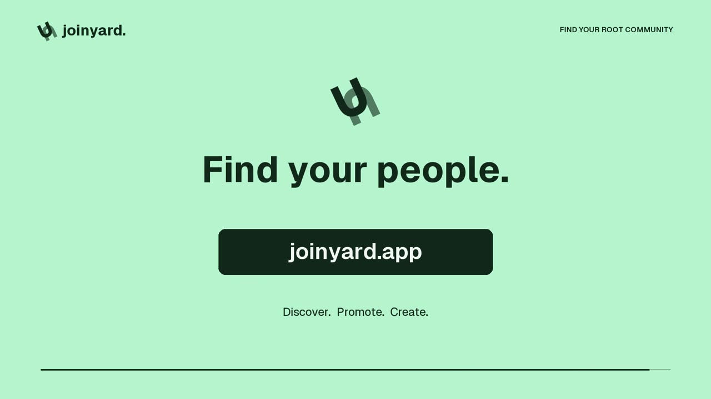

# Joinyard

**Root 커뮤니티 찾기.**

[Joinyard 둘러보기](https://joinyard.app/ko-KR) · [이미지 툴](https://joinyard.app/ko-KR/asset-maker) · [업데이트](https://joinyard.app/ko-KR/announcements?kind=UPDATE) · [English](./README.md)

Joinyard는 취향에 맞는 Root 커뮤니티를 찾고, 내가 운영하는 커뮤니티를 소개하는 곳입니다. 관심사와 언어로 커뮤니티를 살펴보고, 소개 페이지에서 Root 초대 링크로 이동할 수 있습니다.

**현재 [joinyard.app](https://joinyard.app/ko-KR)에서 공개 베타를 이용할 수 있습니다.**

## 25초로 보는 Joinyard

**[V2 보기 — 영어 내레이션 + 모션그래픽](./media/joinyard-promo-v2-motion-voice.mp4)**

25초 · 1080p · 영어 자막 · [자막 파일](./media/joinyard-promo-v2.en.srt)

[V1 보기 — 배경음악 버전](./media/joinyard-promo.mp4)

## 발견하고, 알리고, 꾸미세요

| | 이용할 수 있는 기능 |
| :-- | :-- |
| **커뮤니티 찾기** | 이름으로 검색하거나 카테고리·언어·태그로 찾아보세요. 소개를 읽고 Root 초대 링크로 이동할 수 있습니다. 둘러보기에는 계정이 필요하지 않습니다. |
| **내 커뮤니티 소개** | 로그인 후 커뮤니티를 등록하고, 소개와 초대 링크를 관리할 수 있습니다. |
| **Bump로 홍보** | 공개된 커뮤니티를 웹사이트·Joinyard Bot·Joinyard App에서 Bump할 수 있습니다. 세 방식 모두 동일한 6시간 쿨다운을 공유합니다. |
| **커뮤니티 이미지 만들기** | 이미지 툴에서 채널 아이콘과 이미지를 만들고, 레이어와 색상을 조정해 PNG 또는 ZIP으로 내려받으세요. 편집과 다운로드에는 로그인이 필요합니다. |

## 웹사이트·봇·앱의 차이

- **웹사이트:** 커뮤니티 찾기, 등록·관리, 이미지 툴과 Bump를 브라우저에서 이용합니다.
- **Joinyard Bot:** 연결된 커뮤니티에서 `/bump`를 입력하면 **Joinyard 웹사이트의 커뮤니티가 홍보**됩니다. `/status`로 다음 이용 가능 시점을 확인할 수 있습니다.
- **Joinyard App:** Root 안의 간단한 화면에서 Bump와 상태 확인을 이용합니다. 커뮤니티 찾기와 이미지 툴은 웹사이트로 연결됩니다.

봇과 앱 모두 Root App Store에서 공개되어 있습니다. Root에서 **Joinyard**를 검색해 찾아보세요.

봇과 앱은 선택 사항입니다. 설치하지 않아도 웹사이트에서 커뮤니티 등록과 Bump를 이용할 수 있습니다. 소유자가 봇과 앱을 각각 연결하면 멤버도 Bump할 수 있으며, 어느 방식으로 실행해도 웹사이트의 동일한 Bump 상태와 쿨다운에 반영됩니다.

## 시작하기

1. **커뮤니티 찾기:** [Joinyard](https://joinyard.app/ko-KR)에서 마음에 드는 커뮤니티를 고르고 Root 초대 링크를 여세요.
2. **내 커뮤니티 등록:** 로그인 후 **커뮤니티 등록**에서 소개를 작성하세요.
3. **커뮤니티 홍보:** 공개된 커뮤니티를 웹사이트에서 Bump하거나, **내 커뮤니티**에서 봇 또는 앱을 연결하세요.

웹사이트는 **English, 简体中文, Español, Français, Русский, 한국어, 日本語, Bahasa Melayu**를 지원합니다.

## 바로가기

- [Joinyard 방문](https://joinyard.app/ko-KR)
- [이미지 툴](https://joinyard.app/ko-KR/asset-maker)
- [최근 업데이트](https://joinyard.app/ko-KR/announcements?kind=UPDATE)
- [Joinyard 공식 Root 커뮤니티](https://rootapp.gg/ADH0d_PegQqPVEQY6-Jf2w)
- [개인정보 처리방침](https://joinyard.app/ko-KR/privacy) · [이용약관](https://joinyard.app/ko-KR/terms)
- 문의: [support@joinyard.app](mailto:support@joinyard.app)

## 이 저장소에 대해

Joinyard의 서비스 소개와 홍보 자료를 제공하는 공개 쇼케이스입니다. 실제 애플리케이션의 소스 코드를 제공하는 저장소는 아닙니다.

제작: [YHS-Sec](https://github.com/YHS-Sec). Joinyard는 Root와 제휴하거나 Root의 보증을 받은 서비스가 아닙니다.
